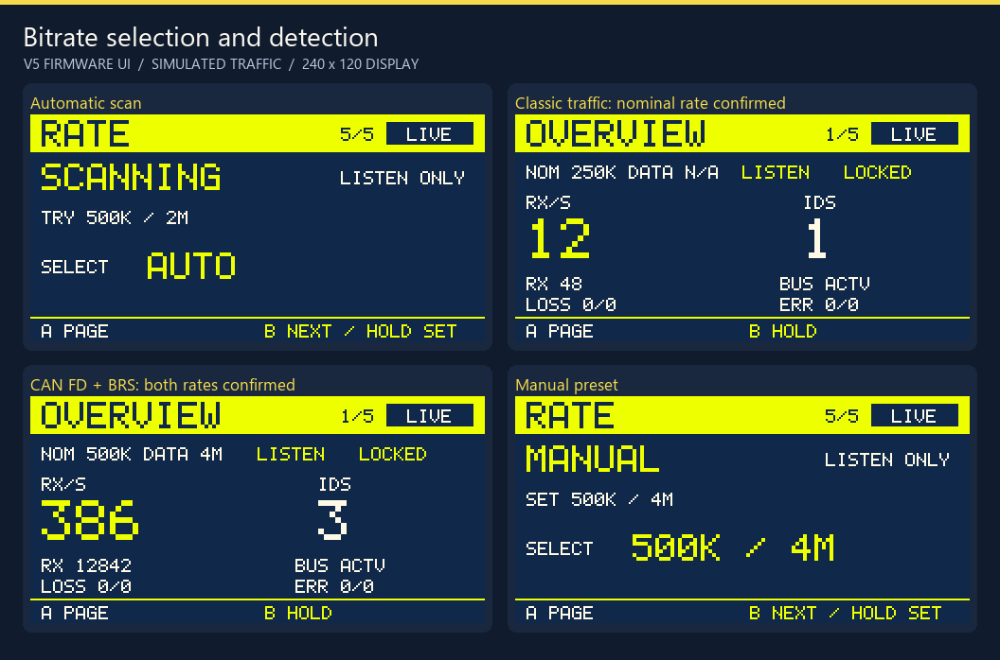
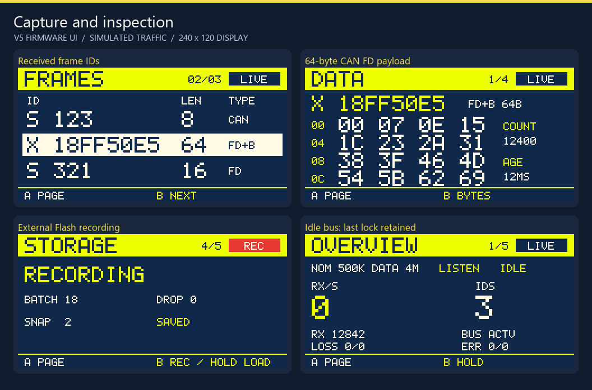

<h1 align="center">XIAO CAN Analyzer</h1>

<p align="center">
  A handheld, listen-only <strong>Classical CAN and CAN FD analyzer</strong> for the <strong>XIAO STM32C5 Console</strong>.<br>
  Automatically detect common bitrates, inspect frames on the <strong>0.95-inch AMOLED</strong>, and log traffic to external Flash.
</p>

<p align="center">
  <a href="https://www.seeedstudio.com/"></a>
  <a href="https://wiki.seeedstudio.com/xiao_stm32c5_getting_started/"></a>
  <a href="#hardware"></a>
  <a href="https://registry.platformio.org/tools/platformio/toolchain-gccarmnoneeabi"></a>
  <a href="https://platformio.org/"></a>
  <a href="https://docs.zephyrproject.org/"></a>
</p>

<p align="center">
  <a href="#bitrate-detection"></a>
  <a href="#capture"></a>
</p>

<p align="center">
  <a href="firmware/latest/firmware_can_analyzer_v5_50pct.uf2?raw=true"></a>
  <a href="#version-history"></a>
  <a href="#display-previews"></a>
</p>

<p align="center">
  <strong><a href="#quick-start">Quick start</a> · <a href="#hardware">Hardware</a> · <a href="#controls">Controls</a> · <a href="#bitrate-detection">Bitrate detection</a> · <a href="#build-from-source">Build from source</a></strong>
</p>

<p align="center">
  
  <a href="README_CN.md"></a>
</p>

---

## Quick start

1. Download the [v5 UF2](https://github.com/lewuq/XIAO_CAN_Analyzer/raw/refs/heads/main/firmware/latest/firmware_can_analyzer_v5_50pct.uf2).
2. Connect the Console over USB-C. Double-press the XIAO RESET button, then copy the UF2 to the `XIAOC5BOOT` drive. The board restarts after copying. [Seeed UF2 guide](https://wiki.seeedstudio.com/xiao_stm32c5_getting_started/#bootloader-usage)
3. Set **SW1 to the CANH/CANL path (A contacts)**. Connect J4-1 to **CANH**, J4-2 to **CANL**, and J4-3 to **GND**.
4. With traffic present, let AUTO find a bitrate. For a known bitrate, open **RATE**, short-press **BOOT** to choose a preset, and hold **BOOT** to apply it.

## Hardware

| Part | Role |
| --- | --- |
| **XIAO STM32C5** | FDCAN2, onboard TCAN3403-Q1 transceiver and 16 MiB of external Flash |
| **Console V1.0** | SH8501G SPI AMOLED, 240 × 120 landscape UI, D0 and BOOT buttons |
| **J4** | Pins 1–3 carry CANH, CANL and GND with SW1 on the A contacts |
| **SW1** | Routes J4 either to the onboard transceiver or to FDCAN1 logic-level TX/RX |

Use the **A contacts** with this firmware. The B contacts need an external CAN FD transceiver and firmware configured for FDCAN1. When tapping into an already terminated bus, check JP1 and disconnect the XIAO’s onboard 120 Ω termination. When the Console terminates one physical end, use a single 120 Ω termination at that end. The analyzer runs silently, so a bench sender needs another node to acknowledge its frames. [XIAO STM32C5 CAN FD guide](https://wiki.seeedstudio.com/xiao_stm32c5_canfd_usage/)

## Controls

| Control | Short press | Hold about 0.7 s |
| --- | --- | --- |
| **D0 / A** | Cycle OVERVIEW → FRAMES → DATA → STORAGE → RATE | Clear current capture statistics |
| **BOOT / B** | Run the page action below | Toggle HOLD on the first three pages, load a snapshot in STORAGE, or apply a bitrate in RATE |

| Page | What you see | B short press |
| --- | --- | --- |
| **OVERVIEW** | Nominal and data rates, scan state, frame rate, ID count and receive loss | Toggle HOLD |
| **FRAMES** | Three ID entries per screen with the latest length and frame type | Select the next ID |
| **DATA** | Latest payload for the selected ID, with age and frame count | Show the next 16 bytes |
| **STORAGE** | Recording state, batch count, logger drops and saved snapshot | Start or stop recording |
| **RATE** | Scan state, active trial or configuration, and pending preset | Select AUTO or the next of 15 presets |

## Bitrate detection

AUTO starts at boot and temporarily tries candidate timings in FDCAN2 bus monitoring mode. The normal trial is about 300 ms. Partial evidence can extend a trial to 12 seconds. AUTO needs ten valid frames to confirm the nominal rate, and ten valid FD+BRS frames at a candidate timing to report a data rate. A quiet bus cannot supply bitrate evidence.

- **SCANNING / DATA SCAN** shows a trial in progress. `DATA N/A` means BRS evidence is insufficient.
- **LOCKED / IDLE** holds the confirmed rate through quiet periods. Apply AUTO again after moving to a different bus.
- **MANUAL** uses the selected nominal/data pair. The RATE page shows `SET`, while the overview reports data rate once it is confirmed.
- **NO VALID** means the last pass lacked sufficient evidence. AUTO retries.

Nominal candidates, in **kbit/s**, are 10, 20, 50, 100, 125, 250, 500, 800 and 1000. Data candidates, in **Mbit/s**, are 0.5, 1, 2, 3, 4, 6 and 8. The driver checks whether the controller clock can produce the timing. High-speed operation and scan latency depend on actual bus traffic and wiring. Frames received while scanning are excluded from capture totals and logs.

## Display previews

The **v5 firmware renderer** generated these screens with simulated CAN traffic.





## Capture

- **HOLD** freezes the view and queues a snapshot of the statistics and up to 64 ID entries in Flash. Live reception continues.
- **Recording** keeps a rolling history in the upper 8 MiB of external Flash. Different bitrate configurations go into separate batches. After stopping, wait for `READY` before disconnecting power.
- **Export** works from the USB CDC terminal at 115200 baud.

```text
capture info
capture dump 1
```

Use the batch number shown by `capture info` in place of `1`. CSV rows include timestamp, ID, flags, length, payload, nominal bitrate and configured data bitrate. The last two fields are zero in records captured by earlier firmware that did not save them.

## Build from source

Install [PlatformIO](https://platformio.org/) and the [Seeed STM32C5 platform](https://wiki.seeedstudio.com/xiao_stm32c5_getting_started/#platformio). Build from the repository root.

```sh
pio pkg install -g -p "https://github.com/Seeed-Studio/platform-seeedboards.git"
pio run -e seeed-xiao-stm32c5
```

The build produces `.pio/build/seeed-xiao-stm32c5/firmware.uf2`. The [overlay](zephyr/app.overlay) maps SPI3, the display control GPIOs, both buttons and the external Flash partitions. [Host tests](test/test_host.c) cover auto-detection, navigation, rendering and window alignment. The [NOR test](test/test_nor.py) checks recovery and bitrate-separated batches with simulated Flash.

## Version history

| Firmware | What changed |
| --- | --- |
| [v5](firmware/latest/firmware_can_analyzer_v5_50pct.uf2) | Added automatic bitrate detection, manual presets and dynamic bitrate display. |
| [v4.1](firmware/history/firmware_can_analyzer_v4_1_50pct.uf2) | Aligned partial display windows to fix corruption during page changes. |
| v4 | Added external Flash capture, snapshots and partial display updates. |
| [v3](firmware/history/firmware_can_analyzer_v3_50pct.uf2) | Added the first standalone FDCAN2 analyzer UI and button controls. |
