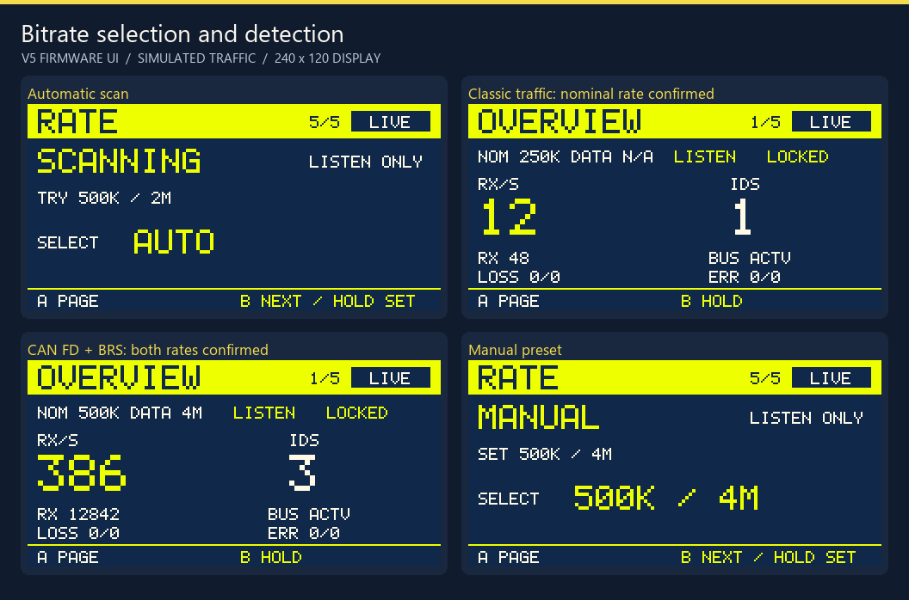

# XIAO CAN Analyzer

基于 XIAO STM32C5 Console 的便携式经典 CAN / CAN FD 分析仪。它以静默模式识别常见波特率，在 0.95 英寸 AMOLED 上显示帧 ID 和载荷，并将报文记录到外置 Flash。

[English](README.md) · [🚀 快速开始](#快速开始) · [🧩 硬件](#硬件) · [🎛 按键](#按键) · [💾 记录](#记录) · [🛠 编译](#从源码编译) · [📦 固件](#版本历史)

## 快速开始

1. 下载 [v5 UF2](https://github.com/lewuq/XIAO_CAN_Analyzer/raw/refs/heads/main/firmware/latest/firmware_can_analyzer_v5_50pct.uf2)。
2. 用 USB-C 连接 Console，快速按两次 XIAO 的 RESET 键。把 UF2 复制到 `XIAOC5BOOT` 盘，设备会自动重启。[Seeed UF2 烧录指南](https://wiki.seeedstudio.com/xiao_stm32c5_getting_started/#bootloader-usage)
3. 将 **SW1 拨到 CANH/CANL 通路（A 组触点）**，再将 **J4-1 接 CANH、J4-2 接 CANL、J4-3 接 GND**。
4. 总线有报文时，等 AUTO 自动确认速率。已知速率时，在 **RATE** 页短按 **BOOT** 选预设，长按应用。

## 硬件

| 部件 | 用途 |
| --- | --- |
| 🧠 **XIAO STM32C5** | FDCAN2、板载 TCAN3403-Q1 收发器和 16 MiB 外置 Flash |
| 🖥 **Console V1.0** | SH8501G SPI AMOLED、240 × 120 横屏界面、D0 和 BOOT 两个按键 |
| 🔌 **J4** | SW1 在 A 档时，1 至 3 脚依次为 CANH、CANL 和 GND |
| 🔀 **SW1** | 将 J4 切到板载收发器或 FDCAN1 逻辑 TX/RX 通路 |

该固件使用 **A 档**。B 档需要外挂 CAN FD 收发器和使用 FDCAN1 的固件。旁路接入已有双端匹配的总线时，检查 JP1 并断开 XIAO 板载的 120 Ω 终端。Console 位于总线物理末端时，该端只需要一个 120 Ω 终端。分析仪静默监听，台架发送端需由其他节点应答 ACK。[XIAO STM32C5 CAN FD 指南](https://wiki.seeedstudio.com/xiao_stm32c5_canfd_usage/)

## 按键

| 按键 | 短按 | 长按约 0.7 秒 |
| --- | --- | --- |
| 🔁 **D0 / A** | 总览 → ID 列表 → 载荷 → 存储 → 速率 | 清空当前采集统计 |
| 🎛 **BOOT / B** | 执行当前页的操作 | 前三页切换 HOLD，存储页恢复快照，速率页应用配置 |

| 页面 | 显示内容 | B 短按 |
| --- | --- | --- |
| 📊 **OVERVIEW** | 仲裁速率、数据速率、扫描状态、帧率、ID 数和接收损失 | 切换 HOLD |
| 📋 **FRAMES** | 每屏三条 ID 及最新帧长度、类型 | 选下一条 ID |
| 🔍 **DATA** | 选中 ID 的最新载荷、计数和距最近接收的时间 | 看下一组 16 字节 |
| 💾 **STORAGE** | 录制状态、批次数、录制丢帧数及快照 | 开始或停止录制 |
| ⚙️ **RATE** | 扫描状态、试探或当前配置、待应用的预设 | 循环选择 AUTO 和 15 个预设 |

## 波特率识别

开机默认为 AUTO。分析仪用 FDCAN2 静默轮试候选位时序，常规观察窗口约 300 ms，已有部分证据时最长可延至 12 秒。AUTO 用 10 帧有效报文确认仲裁速率，用同一个候选速率下 10 帧有效 FD+BRS 报文确认数据速率。总线完全静默时无法识别速率。

- 🔎 **SCANNING / DATA SCAN** 表示仍在试探。`DATA N/A` 表示 BRS 证据不足。
- 🔒 **LOCKED / IDLE** 保留已确认的速率。换总线后可在 RATE 页重新应用 AUTO。
- 🎚 **MANUAL** 使用选定的组合。RATE 页的 `SET` 显示配置值，总览在有足够证据后显示数据速率。
- ⏳ **NO VALID** 表示本轮证据不足，AUTO 会重试。

仲裁候选为 **10、20、50、100、125、250、500、800、1000 kbit/s**，数据候选为 **0.5、1、2、3、4、6、8 Mbit/s**。驱动校验位时序，实际高速通信和识别用时取决于总线流量与接线。扫描阶段接收的试探帧不计入采集统计或日志。

## 界面预览

由 **v5 固件的同一套界面渲染代码**绘制。预览中的帧和计数为模拟数据。




## 记录

- ⏸ **HOLD** 冻结界面并将统计及最多 64 个 ID 的最新数据排队存入 Flash，后台继续接收。
- 💾 **录制**在外置 Flash 后 8 MiB 循环保存，不同速率配置分别分批。停止后等待 `READY` 再断电。
- 📤 **导出**使用 115200 波特率的 USB CDC 终端。

```text
capture info
capture dump 1
```

把 `1` 换成 `capture info` 显示的批次号。CSV 包含时间、ID、标志、长度、载荷、仲裁速率和配置的数据速率。旧固件未保存的速率字段在导出时显示为 0。

## 从源码编译

安装 [PlatformIO](https://platformio.org/) 和 [Seeed STM32C5 平台](https://wiki.seeedstudio.com/xiao_stm32c5_getting_started/#platformio)，在仓库根目录运行：

```sh
pio pkg install -g -p "https://github.com/Seeed-Studio/platform-seeedboards.git"
pio run -e seeed-xiao-stm32c5
```

产物位于 `.pio/build/seeed-xiao-stm32c5/firmware.uf2`。[设备树覆盖文件](zephyr/app.overlay) 定义屏幕、按键和外置 Flash 分区。[主机测试](test/test_host.c) 覆盖速率扫描、按键导航、渲染和局部窗口对齐。[NOR 测试](test/test_nor.py) 验证掉电恢复和按速率分批。

## 版本历史

| 固件 | 更新内容 |
| --- | --- |
| 🚀 [v5](firmware/latest/firmware_can_analyzer_v5_50pct.uf2) | 加入自动波特率识别、手动预设和动态速率显示。 |
| 🩹 [v4.1](firmware/history/firmware_can_analyzer_v4_1_50pct.uf2) | 对齐局部刷新窗口，修复切页花屏。 |
| 💾 v4 | 加入外置 Flash 录制、快照和局部刷新。 |
| 🧰 [v3](firmware/history/firmware_can_analyzer_v3_50pct.uf2) | 初版 FDCAN2 分析仪界面及双按键操作。 |
